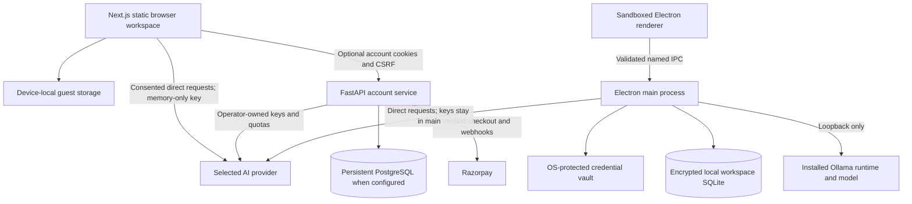

# Architecture

The desktop renderer hosts the same exported web application. It has no Node or arbitrary filesystem access. Named IPC operations validate the calling frame, payload, provider and file limits. Main-process responses expose normalized text/usage/status, not credentials. Token chunks carry request IDs; cancellation aborts the corresponding upstream request.

Browser guest work uses local browser storage and is not encrypted by the application. Desktop records use a separate SQLite store with OS-encrypted payloads. The optional local FastAPI SQLite database is a different service database; production account hosting requires PostgreSQL. A serverless function without PostgreSQL serves only public catalog/readiness endpoints and rejects personal account operations.

## Personalization and memory

Profiles, extracted resumes, documents, practice answers and mentor conversation turns remain editable data. Mentor requests include recent conversation turns plus bounded relevant profile/document/session passages. The source selector uses lexical ranking and deduplication. Earlier AI responses are labeled untrusted reference material and may be corrected. This is retrieval and conversation memory, not modification of model weights or a promise that every earlier fact fits in every request.

## Explicit media processing

User-selected images stay temporary until a consented provider request. Reviewed image extraction can be saved as labeled text in Documents and Sessions; the original image is not silently persisted. OpenAI/Gemini/Claude browser adapters use fixed official endpoints; the desktop image bridge currently supports OpenAI.

Microphone dictation, browser speech recognition and selected system/tab audio have visible start/stop controls. Browser speech can use the browser vendor's service. Provider transcription uses explicit OpenAI consent and the user's direct browser/vault key; independent short recordings and bounded queues support the live workflow. Tests used synthetic audio/images and mocked acquisition, not private conversations or screen content.

## Account and billing boundary

Passwords are scrypt-derived; session and CSRF tokens are persisted as hashes. Records are owner-scoped. Revocation, cloud consent and database-backed rate/quota windows are enforced by the API. Provider keys submitted by clients are rejected; optional operator inference is a separate service with its own credentials and budget.

Razorpay entitlement changes require signature verification, captured funds, matching amount/currency and owned subscription/invoice membership. Webhook event IDs/body hashes are idempotent, and stale events cannot overwrite newer billing state. Missing merchant setup yields unavailable checkout, not simulated paid access.

## Code execution boundary

Browser JavaScript runs in a dedicated worker inside an opaque-origin sandboxed iframe with networking disabled and a parent execution timeout. Other languages use an optional independently isolated runner. The API never evaluates candidate code in its own process. The operator must verify the actual runner isolation; a contract flag is not an independent security attestation.

See VALIDATION.md for tested behavior and remaining setup limits, THREAT_MODEL.md for controls, and API.md for exact API/environment contracts.
